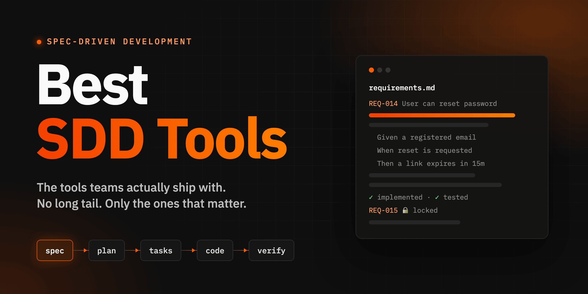

  

  <b>The spec-driven development tools that matter.</b> 
  The ones teams actually ship with, not every weekend experiment.

  
  
  

  <a href="#-spec-platforms">Spec Platforms</a> ·
  <a href="#-spec-toolkits">Spec Toolkits</a> ·
  <a href="#-agent-methodologies">Agent Methodologies</a> ·
  <a href="#-ides">IDEs</a> ·
  <a href="#-task--workflow-management">Task & Workflow</a> ·
  <a href="#-standards">Standards</a>

---

[Spec-driven development](https://martinfowler.com/articles/exploring-gen-ai/sdd-3-tools.html) means writing the specification first and letting it drive the code, tests and review. With AI coding agents it is the difference between guessing and engineering.

> [!NOTE]
> **Inclusion bar:** an established product from a known company, or an open-source project with 10k+ GitHub stars and active maintenance. Looking for the long tail? See [Related](#-related).

## 🟠 Spec Platforms

<table>
<tr>
<td width="100%">

### [Entalpa](https://entalpa.com)

Persistent, MCP-native spec layer for AI coding agents: stakeholders, user stories and requirements with acceptance criteria, open questions raised before the build, locked requirements, and traceability to code and tests.

Works with **Claude Code**, **Cursor** and **Codex**, and composes with Spec Kit and OpenSpec instead of replacing them.

[Website](https://entalpa.com) · [MCP & Skills](https://github.com/entalpa/entalpa-mcp)

</td>
</tr>
</table>

## 📐 Spec Toolkits

| Tool | Stars | What it does |
|---|---|---|
| **[Spec Kit](https://github.com/github/spec-kit)** |  | GitHub's open-source toolkit: `specify`, `plan`, `tasks`, `implement` commands that turn product scenarios into a spec, a technical plan and an ordered task list for any coding agent. |
| **[OpenSpec](https://github.com/Fission-AI/OpenSpec)** |  | Lightweight change-based specs (proposal, spec deltas, design, tasks) that align humans and AI assistants before code is written; strong fit for brownfield repos. |

## 🧭 Agent Methodologies

| Tool | Stars | What it does |
|---|---|---|
| **[Superpowers](https://github.com/obra/superpowers)** |  | Skills-based development methodology for coding agents: brainstorm, approved spec, written plan, subagent execution with TDD and review. |
| **[Agent Skills](https://github.com/addyosmani/agent-skills)** |  | Production-grade skill pack with explicit spec-to-plan-to-build workflows and quality gates. |
| **[BMAD-METHOD](https://github.com/bmad-code-org/BMAD-METHOD)** |  | Agile AI-driven development with role agents (analyst, PM, architect, scrum master, dev, QA) that hand off PRDs, architecture docs and stories. |
| **[GSD](https://github.com/open-gsd/gsd-core)** |  | Light-weight meta-prompting, context engineering and spec-driven development system for coding agents. |

## 💻 IDEs

| Tool | Backed by | What it does |
|---|---|---|
| **[Kiro](https://kiro.dev)** | AWS | Agentic IDE built around specs: requirements in EARS notation, design and task files, plus hooks and steering docs. |

## 📋 Task & Workflow Management

| Tool | Stars | What it does |
|---|---|---|
| **[Taskmaster](https://github.com/eyaltoledano/claude-task-master)** |  | Parses a PRD into dependency-ordered tasks and drives implementation in Cursor, Claude Code and other agents. |
| **[Vibe Kanban](https://github.com/BloopAI/vibe-kanban)** |  | Kanban board that runs Claude Code, Codex and other agents in parallel, one isolated worktree per task, with review before merge. |

## 📜 Standards

| Standard | Stars | What it does |
|---|---|---|
| **[AGENTS.md](https://github.com/agentsmd/agents.md)** |  | Open Markdown format for guiding coding agents, read by most major agents. |

## 🔗 Related

- [Awesome Spec-Driven Development](https://github.com/engineering4ai/awesome-spec-driven-development) - The long-tail list: every SDD tool, big and small.

---

## Contributing

PRs welcome for tools that meet the inclusion bar. One row per tool, factual description, no marketing superlatives.

Released under <a href="LICENSE">CC0 1.0</a>

